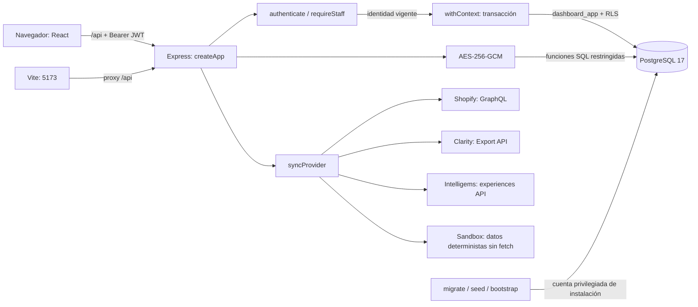
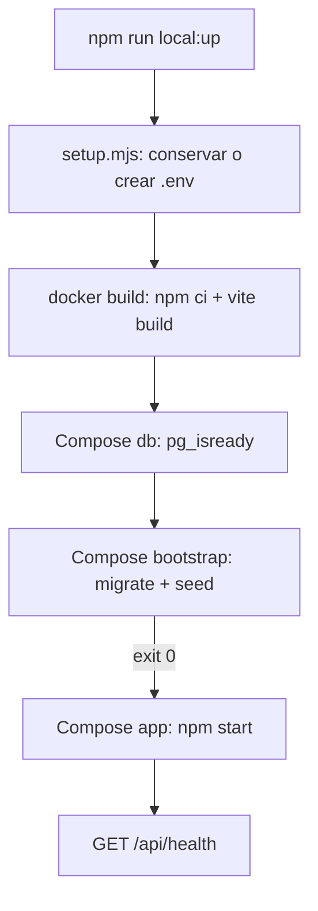

# Arquitectura y responsabilidad de archivos

## Producto y alcance

Centraliza reúne datos de las tiendas de **una agencia**. Una tienda es un tenant; varios usuarios cliente pueden pertenecer a esa tienda. Cada cliente tiene exactamente una tienda. Los empleados tienen `store_id = NULL`, y sus permisos se determinan por el rol, no por ese valor nulo.

El MVP tiene autenticación, lectura de dashboards, creación de tiendas y accesos, almacenamiento de credenciales, adaptadores para los tres proveedores, sincronización manual, exportación CSV e históricos. Sandbox permite recorrer el mismo flujo de persistencia sin cuentas externas. No existe una entidad de agencias, facturación SaaS ni enrutamiento entre distintas agencias.

## Conexiones principales

En Docker, Express sirve también `client/dist` y el navegador usa una sola dirección: `http://localhost:8080`. En desarrollo, el navegador entra por Vite en `5173` y Vite reenvía `/api` a Express en `3001`. No se configura CORS porque ambos flujos presentan la API bajo el mismo origen del navegador.

## Inicio y dependencias de servicios

`bootstrap` es un contenedor de ejecución única; terminar con código `0` es su resultado normal. `app` no recibe `DATABASE_ADMIN_URL`. Los procesos no se almacenan en Git: al iniciar otra máquina hay que volver a arrancar los servicios.

## Mapa completo de archivos de ejecución y configuración

| Archivo | Responsabilidad | Se conecta con |
| --- | --- | --- |
| `package.json` | Workspaces y comandos comunes; exige Node >= 22.12 | `server/package.json`, `client/package.json`, scripts, Playwright |
| `package-lock.json` | Versiones, URLs e integridad de dependencias para `npm ci` | Todos los manifiestos; instalación local, Docker y CI |
| `scripts/setup.mjs` | Genera claves y `.env` cuando no existe | `node:crypto`, sistema de archivos |
| `scripts/local-up.mjs` | Construye la imagen y arranca Compose; adapta proxy/CA de instalación | `setup.mjs`, Docker CLI, DNS del host |
| `Dockerfile` | Instala dependencias, compila la interfaz y ejecuta Node como usuario `node` | Manifiestos, fuente, `client/dist`, Compose |
| `compose.yaml` | PostgreSQL, bootstrap, app, volumen y comprobaciones de salud | `.env`, imagen, puertos 5432/8080 |
| `.env.example` | Nombres y propósito básico de variables, sin claves utilizables | `setup.mjs`, `config.js`, Compose |
| `.gitignore` | Excluye `.env`, dependencias, compilación y artefactos de pruebas de Git | Git |
| `.dockerignore` | Excluye `.git`, `.env`, dependencias del host y artefactos de la imagen | Docker build |
| `.github/workflows/ci.yml` | Ejecuta instalación, migración, demo, pruebas y compilación en GitHub Actions | PostgreSQL de CI, Node 24 y Playwright |
| `AGENTS.md` | Reglas para modificar y validar el proyecto | Colaboradores y agentes |
| `README.md` | Entrada al proyecto e instalación rápida | Documentación técnica y comandos |
| `client/package.json` | React, React DOM, Vite y plugin React | Workspace raíz |
| `client/index.html` | HTML en español, metadatos, favicon y contenedor `#root` | `src/main.jsx`, `public/favicon.svg` |
| `client/src/main.jsx` | Monta `App` con `createRoot` y `React.StrictMode`; importa CSS | React DOM, `App.jsx`, `styles.css` |
| `client/src/App.jsx` | Sesión, pantallas, formularios, componentes y comunicación HTTP | `/api`, `localStorage`, hooks React |
| `client/src/styles.css` | Estilos, estados visuales, modales y adaptación a móvil | Clases de `App.jsx`; fuentes de Google opcionales |
| `client/public/favicon.svg` | Icono estático de la aplicación | HTML y compilación Vite |
| `client/vite.config.js` | Plugin React, puerto 5173 estricto y proxy API | Express en `localhost:3001` |
| `server/package.json` | Express, pg, JWT, Argon2, Helmet, dotenv y rate limit | Workspace raíz |
| `server/src/index.js` | Valida configuración, escucha y cierra recursos | `createApp`, `config`, `pool` |
| `server/src/config.js` | Carga `.env` raíz y reúne parámetros del proceso | Variables inyectadas; consumidoras del servidor |
| `server/src/app.js` | Handlers HTTP, consultas, períodos, estadística y persistencia de sync | Auth, seguridad, DB y adaptadores |
| `server/src/auth.js` | Login, validación JWT, usuario vigente y permiso de empleado | Funciones SQL de autenticación, Argon2, JWT |
| `server/src/db.js` | Pool limitado y contexto RLS por transacción | PostgreSQL, handlers |
| `server/src/security.js` | Validación, DTO públicos, selección de tienda y cifrado | Configuración, auth y handlers |
| `server/src/analytics.js` | Prueba z bilateral y lift mediante función pura | Mapeo de variantes en dashboard y pruebas matemáticas |
| `server/providers/index.js` | Adaptadores HTTPS, Sandbox, validaciones, conversión de datos y errores sanitizados | Shopify, Clarity e Intelligems |
| `server/scripts/migrate.js` | Crea/configura `dashboard_app` e instala el esquema | URL administrativa, URL limitada, `db/schema.sql` |
| `server/scripts/seed.js` | Crea muestras y cuentas únicamente en modo demo | SQL, Argon2, tablas del producto |
| `server/scripts/bootstrap.js` | Crea el primer Super Admin de una base sin demo | Variables `ADMIN_*`, URL administrativa |
| `db/schema.sql` | DDL, funciones, RLS, restricciones y permisos | PostgreSQL; scripts y backend |
| `db/README.md` | Resumen del contrato PostgreSQL | Esquema y referencia detallada |
| `server/providers/README.md` | Compatibilidad y significado de adaptadores | Código de proveedores y referencia detallada |
| `server/test/integration.test.js` | Autenticación, API, importación, períodos e históricos con DB real | `createApp`, pools, JWT y cifrado |
| `server/test/analytics.test.js` | Casos de referencia, límites y entradas inválidas de prueba z | `calculateZTest`; sin consultas DB |
| `server/test/security.test.js` | Proyección segura de históricos y metadata de auditoría | `publicSyncRun`, `publicAuditEvent`; sin consultas DB |
| `server/providers/providers.test.js` | Normalización, errores y Sandbox sin cuentas externas | `syncProvider`, `ProviderError`, `fetch` sustituido |
| `tests/browser/dashboard.spec.js` | Flujos completos de interfaz, exportación y permisos | Playwright, API, DB para limpiar fixtures |
| `playwright.config.js` | Navegador, URL, servidor, reintentos y trazas | Suite de navegador y servidor compilado |
| `docs/*.md` | Referencia funcional y operativa del código propio | Todos los archivos anteriores |

La documentación del código propio no reproduce el código de `node_modules` ni detalla internamente cada librería de terceros. Los contratos usados de esas librerías sí se explican en los catálogos.

## Decisiones y efectos

- **PostgreSQL compartido + RLS:** simplifica operar una agencia con varias tiendas y aplica el aislamiento a consultas SQL, además del backend.
- **Identidad vigente por petición:** JWT identifica al usuario por `sub`; el rol y la tienda se leen de PostgreSQL en cada petición protegida.
- **Una integración por proveedor y tienda:** `UNIQUE(store_id, provider)` hace posible reemplazar credenciales sin duplicar la integración.
- **Credenciales en tabla separada:** los DTO de integraciones no incluyen valores cifrados ni claves.
- **Sincronización fuera de la transacción inicial:** las peticiones HTTPS no retienen una conexión PostgreSQL; el resultado se guarda en otra transacción.
- **React con estado local:** las vistas cambian mediante `page`, no mediante React Router. Recargar restaura la sesión, pero vuelve a Resumen.
- **JSONB complementario:** se usa para metadatos y respuesta de Clarity; métricas consultables, relaciones y restricciones siguen en columnas SQL.
- **Snapshots acumulados:** Intelligems y Clarity se leen sin sumar capturas solapadas; cada fuente conserva el período que representa.
- **Procedencia Sandbox explícita:** metadata.mock identifica la caché sincronizada. Una nueva credencial no cambia su origen hasta que sync termina correctamente.

## Flujos que no existen todavía

No hay rutas de edición/eliminación de tiendas o usuarios, restablecimiento de contraseña, refresh token, revocación de sesión por logout, instalación OAuth Shopify, cron de sincronización, webhooks ni selector de fechas arbitrarias. La exportación disponible es CSV en el navegador; no hay informes programados o enviados por correo. Que una tabla permita SQL adicional no implica que exista un botón o una API para hacerlo.
