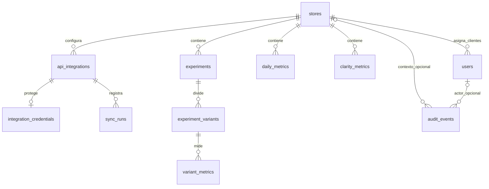

# PostgreSQL: esquema, columnas, relaciones y RLS

Fuente autoritativa: [db/schema.sql](../db/schema.sql). Se instala con cuenta administrativa mediante `db:migrate`. El producto usa PostgreSQL 17; `gen_random_uuid()` es incorporada y no requiere `uuid-ossp`.

## Convenciones

- Los ids propios son UUID con default `gen_random_uuid()`. `integration_credentials` usa el id de su padre, sin UUID nuevo.
- `NOT NULL` exige dato; columnas marcadas “nullable” lo permiten explícitamente por ausencia de esa restricción.
- Fechas de negocio son `date`; momentos son `timestamptz`. PostgreSQL conserva el momento; la zona visible depende de sesión o consumidor.
- `created_at`/`updated_at` con default `now()` se inicializan al insertar. **No hay trigger para actualizar `updated_at`** y los handlers actuales no lo actualizan sistemáticamente.
- Las restricciones text + `CHECK` implementan estados/roles; no son tipos ENUM PostgreSQL.

## Relaciones

`users.store_id` es nullable para empleados; la relación stores→users representa clientes asignados. Cada tabla hija con referencia compuesta conserva `store_id` para impedir unir entidades de tiendas distintas.

## Diccionario completo de columnas

### `stores` — tienda/tenant

| Columna | Tipo / nulabilidad / default | Propósito y restricción |
| --- | --- | --- |
| `id` | UUID, PK, generado | Identidad del tenant |
| `name` | text, requerido | Nombre no vacío tras trim |
| `domain` | text, requerido | Único y minúsculas; patrón Shopify se verifica en backend/adaptador |
| `status` | text, requerido, `active` | `active` o `paused`; la API no expone edición y no aplica bloqueo por paused |
| `currency` | char(3), requerido, `USD` | Tres letras mayúsculas |
| `timezone` | text, requerido, `UTC` | Zona de calendario; validación IANA en alta API |
| `created_at` | timestamptz, requerido, now | Creación |
| `updated_at` | timestamptz, requerido, now | Campo preparado para actualización explícita |

La usan listado, dashboard, alta de clientes, integraciones y RLS.

### `users` — cuentas y permisos

| Columna | Tipo / nulabilidad / default | Propósito y restricción |
| --- | --- | --- |
| `id` | UUID PK generado | JWT sub y contexto de usuario |
| `store_id` | UUID nullable | FK stores, ON DELETE RESTRICT |
| `role` | text requerido | `SUPER_ADMIN`, `ADMIN`, `CLIENT` |
| `name` | text requerido | Nombre no vacío |
| `email` | text requerido | Único, minúsculas y sin espacios externos |
| `password_hash` | text requerido | Debe comenzar `$argon2id$`; nunca DTO público |
| `status` | text requerido, active | `active` o `disabled`; auth exige active |
| `created_at` | timestamptz requerido, now | Creación |
| `updated_at` | timestamptz requerido, now | Actualización explícita pendiente |

`users_role_store_check`: CLIENT exige store no nulo; ADMIN/SUPER_ADMIN exigen nulo. Cambiar rol desde SQL requiere respetar simultáneamente esa condición. El CHECK no concede acceso global; las políticas evalúan el rol.

### `api_integrations` — metadata de conexiones

| Columna | Tipo / nulabilidad / default | Propósito y restricción |
| --- | --- | --- |
| `id` | UUID PK generado | Identidad de integración |
| `store_id` | UUID requerido | FK stores, RESTRICT |
| `provider` | text requerido | shopify/clarity/intelligems |
| `status` | text requerido, disconnected | disconnected/demo/credential_saved/connected/error |
| `external_id` | text nullable | Dominio, proyecto o cuenta externa |
| `scopes` | text[] requerido, array vacío | Permisos declarados; los handlers actuales no los rellenan/verifican |
| `metadata` | JSONB requerido, `{}` | Objeto no secreto; CHECK jsonb_typeof = object |
| `last_synced_at` | timestamptz nullable | Última sincronización exitosa; seed demo asigna now sintético |
| `last_error` | text nullable | Diagnóstico sanitizado de fallo |
| `created_at` | timestamptz requerido, now | Creación |
| `updated_at` | timestamptz requerido, now | Actualización explícita |

UNIQUE `(store_id,provider)` evita conexiones duplicadas. UNIQUE `(id,store_id)` permite las FK compuestas. El esquema reinstala explícitamente el CHECK de status para incluir `credential_saved`.

### `integration_credentials` — envelope cifrado

| Columna | Tipo / nulabilidad / default | Propósito y restricción |
| --- | --- | --- |
| `integration_id` | UUID PK | Una credencial por integración |
| `store_id` | UUID requerido | Parte de FK compuesta |
| `ciphertext` | text requerido | JSON envelope AES-GCM, longitud >0; no token plano |
| `updated_at` | timestamptz requerido, now | `store_credential` lo actualiza al reemplazar |

FK `(integration_id,store_id)` → api_integrations `(id,store_id)`, ON DELETE CASCADE. La clave de cifrado no está en esta tabla. No hay SELECT directo concedido a runtime; se usan funciones restringidas.

### `daily_metrics` — agregado diario de tienda

| Columna | Tipo / nulabilidad / default | Propósito y restricción |
| --- | --- | --- |
| `id` | UUID PK generado | Identidad de fila |
| `store_id` | UUID requerido | FK stores, RESTRICT |
| `date` | date requerido | Fecha de creación de cohorte de pedidos |
| `currency` | char(3) requerido | CHECK tres letras mayúsculas |
| `revenue` | numeric(18,2), requerido, 0 | Total Shopify documentado; muestra sintética en demo |
| `orders` | integer requerido, 0 | No negativo |
| `sessions` | integer nullable | No negativo si existe; ausencia no equivale a cero |
| `conversion_rate` | numeric(9,6) nullable | Fracción 0..1; la respuesta API usa porcentaje calculado |
| `source` | text requerido, shopify | demo o shopify |
| `created_at` | timestamptz requerido, now | Creación |
| `updated_at` | timestamptz requerido, now | Actualización explícita |

UNIQUE `(store_id,date,currency,source)` es el conflict target del importador. El handler no utiliza `conversion_rate` para el resumen: calcula pedidos/sesiones cuando dispone de sesiones. La definición real de revenue está en [Integraciones](integraciones.md).

### `experiments` — prueba A/B

| Columna | Tipo / nulabilidad / default | Propósito y restricción |
| --- | --- | --- |
| `id` | UUID PK generado | Identidad interna |
| `store_id` | UUID requerido | FK stores, RESTRICT |
| `external_id` | text nullable | Identificador del proveedor o de la muestra |
| `name` | text requerido | No vacío |
| `status` | text requerido, draft | draft/active/completed |
| `started_at` | timestamptz nullable | Inicio |
| `ended_at` | timestamptz nullable | Fin; no anterior a inicio cuando ambos existen |
| `source` | text requerido, intelligems | demo/intelligems |
| `metadata` | JSONB requerido, `{}` | Objeto; `confidence` puede leerse para presentar resultados |
| `created_at` | timestamptz requerido, now | Creación |
| `updated_at` | timestamptz requerido, now | Actualización explícita |

UNIQUE `(id,store_id)` y `(store_id,source,external_id)`. Un `external_id` null no evita duplicados de la misma manera que un identificador presente. Importación real pendiente.

### `experiment_variants` — variante/control

| Columna | Tipo / nulabilidad / default | Propósito y restricción |
| --- | --- | --- |
| `id` | UUID PK generado | Identidad interna |
| `store_id` | UUID requerido | Tenant de la prueba |
| `experiment_id` | UUID requerido | Padre |
| `external_id` | text nullable | Identidad de proveedor |
| `name` | text requerido | No vacío |
| `is_control` | boolean requerido, false | Variante original/control |
| `created_at` | timestamptz requerido, now | Creación; no hay updated_at |

FK `(experiment_id,store_id)` → experiments `(id,store_id)`, CASCADE. UNIQUE `(id,store_id)` y `(experiment_id,external_id)`. Índice parcial único por experiment_id WHERE is_control permite **como máximo** un control; no exige que haya alguno.

### `variant_metrics` — medición de variante

| Columna | Tipo / nulabilidad / default | Propósito y restricción |
| --- | --- | --- |
| `id` | UUID PK generado | Identidad |
| `store_id` | UUID requerido | Tenant |
| `variant_id` | UUID requerido | Variante medida |
| `date` | date requerido | Fecha de medición/snapshot |
| `visitors` | integer requerido, 0 | No negativo |
| `orders` | integer requerido, 0 | No negativo; API lo llama conversions |
| `revenue` | numeric(18,2) requerido, 0 | Ingresos de variante |
| `currency` | char(3) requerido, USD | Tres letras mayúsculas |
| `source` | text requerido, intelligems | demo/intelligems |
| `created_at` | timestamptz requerido, now | Creación |
| `updated_at` | timestamptz requerido, now | Actualización explícita |

FK `(variant_id,store_id)` → experiment_variants `(id,store_id)`, CASCADE. UNIQUE `(variant_id,date,currency,source)`. No exige orders <= visitors: pedidos y visitantes no son intercambiables; un futuro adaptador debe definir su población y conversiones.

### `clarity_metrics` — comportamiento de tienda

| Columna | Tipo / nulabilidad / default | Propósito y restricción |
| --- | --- | --- |
| `id` | UUID PK generado | Identidad |
| `store_id` | UUID requerido | FK stores, RESTRICT |
| `date` | date requerido | Fecha diaria demo o captura de snapshot real |
| `sessions` | integer nullable | No negativo si disponible |
| `dead_clicks` | integer nullable | Conteo compatible; real actualmente null |
| `rage_clicks` | integer nullable | Conteo compatible; real actualmente null |
| `quick_backs` | integer nullable | Conteo compatible; real actualmente null |
| `scroll_depth` | numeric(5,2) nullable | 0..100; adaptador lo conserva, API actual no lo muestra |
| `source` | text requerido, clarity | demo/clarity |
| `metadata` | JSONB requerido, `{}` | Objeto: aggregation, windowDays, snapshotDate, projectId y response |
| `created_at` | timestamptz requerido, now | Creación |
| `updated_at` | timestamptz requerido, now | Actualización explícita |

UNIQUE `(store_id,date,source)` reemplaza el snapshot de esa fecha al repetir importación. No hay FK hacia variante: no existe atribución A/B verificada.

### `sync_runs` — ejecución de sincronización

| Columna | Tipo / nulabilidad / default | Propósito y restricción |
| --- | --- | --- |
| `id` | UUID PK generado | Ejecución |
| `store_id` | UUID requerido | Tenant |
| `integration_id` | UUID requerido | Integración |
| `status` | text requerido, running | running/completed/failed |
| `started_at` | timestamptz requerido, now | Inicio |
| `finished_at` | timestamptz nullable | Fin, >= inicio si existe |
| `error` | text nullable | Mensaje sanitizado |
| `records_processed` | integer requerido, 0 | No negativo; filas persistidas |

FK compuesta hacia api_integrations, CASCADE. No hay endpoint de consulta de runs ni worker que rescate ejecuciones running tras un cierre abrupto.

### `audit_events` — auditoría parcial

| Columna | Tipo / nulabilidad / default | Propósito y restricción |
| --- | --- | --- |
| `id` | UUID PK generado | Evento |
| `store_id` | UUID nullable | FK stores, RESTRICT; null para evento global |
| `actor_user_id` | UUID nullable | FK users, SET NULL si se elimina actor |
| `action` | text requerido | No vacío; hoy user.created / integration.connected |
| `metadata` | JSONB requerido, `{}` | Objeto: ids/rol/proveedor, sin secretos |
| `created_at` | timestamptz requerido, now | Momento del evento |

No se auditan todavía todas las operaciones. No hay endpoint/UI de auditoría. Runtime solo recibe SELECT e INSERT; no UPDATE/DELETE.

## Índices explícitos y unicidad

Las PK y UNIQUE crean índices propios. Estos son los índices adicionales declarados:

| Índice | Columnas / condición | Uso |
| --- | --- | --- |
| `users_store_id_idx` | store_id | Usuarios asignados a tenant |
| `integration_credentials_store_id_idx` | store_id | Credenciales de tenant |
| `experiments_store_id_status_idx` | store_id,status | Experimentos por tienda/estado |
| `experiment_variants_single_control_idx` | experiment_id WHERE is_control, UNIQUE | Evita dos controles |
| `experiment_variants_store_id_idx` | store_id | Lectura de variantes |
| `variant_metrics_store_id_date_idx` | store_id,date | Mediciones por tienda/período |
| `sync_runs_store_id_started_at_idx` | store_id,started_at DESC | Histórico de ejecuciones |
| `audit_events_store_id_created_at_idx` | store_id,created_at DESC | Histórico de auditoría |

No todos los FK tienen un índice separado de store_id: algunos quedan cubiertos por índices UNIQUE cuyo primer campo es store_id.

## Las seis funciones SQL

| Función | Entrada → salida | Algoritmo y consumidores |
| --- | --- | --- |
| `app_is_staff()` | Ninguna → boolean | Evalúa `current_setting('app.role',true)` en ADMIN/SUPER_ADMIN; coalesce a false. SQL STABLE. Usada por RLS y funciones de credenciales |
| `app_store_visible(target_store_id uuid)` | Tenant → boolean que puede ser null | Staff ve todo; CLIENT compara tenant con app.store_id. Sin contexto no autoriza. SQL STABLE; usada por SELECT de tiendas y tablas de tenant |
| `auth_lookup(lookup_email text)` | Correo → SETOF users | Normaliza email y busca una fila. SECURITY DEFINER, STABLE. `login` recibe hash internamente |
| `auth_user(lookup_id uuid)` | Id → SETOF users | Busca identidad vigente por id. SECURITY DEFINER, STABLE. `authenticate` determina rol/status actual |
| `store_credential(target_integration_id uuid, encrypted_value text)` | Integración y envelope → void | PL/pgSQL SECURITY DEFINER: exige staff (`42501`), envelope no vacío (`22023`), integración existente (`P0002`); toma su store_id, hace upsert y actualiza timestamp. Usada por connect |
| `read_credential(target_integration_id uuid)` | Integración → text/null | PL/pgSQL SECURITY DEFINER: exige staff (`42501`); lee ciphertext de id o devuelve null. Usada por sync, nunca por una ruta de lectura pública |

Todas fijan `search_path = pg_catalog, public, pg_temp`. EXECUTE se revoca de PUBLIC y se concede a dashboard_app. Las cuatro funciones SECURITY DEFINER se ejecutan como propietario privilegiado del esquema; por ello pueden leer datos que RLS niega al rol de ejecución. La aplicación debe mantener estas funciones en el backend privado.

## Políticas RLS y grants

RLS se habilita y fuerza en las 11 tablas. Se crean para `dashboard_app`, distinto del propietario, sin SUPERUSER/BYPASSRLS. Policies son permisivas: cuando aplican varias, sus condiciones se combinan con OR. WITH CHECK evalúa la nueva fila en inserción/actualización.

| Tabla / policy | Operación | Condición |
| --- | --- | --- |
| stores / `stores_read` | SELECT | app_store_visible(id) |
| stores / `stores_write` | ALL | app_is_staff en USING y WITH CHECK |
| users / `users_read` | SELECT | Staff o id del propio app.user_id |
| users / `users_write` | ALL | SUPER_ADMIN cualquier rol; ADMIN únicamente filas role=CLIENT antes y después |
| api_integrations, daily_metrics, experiments, experiment_variants, variant_metrics, clarity_metrics, sync_runs / `tenant_read` | SELECT | app_store_visible(store_id) |
| Esas siete tablas / `staff_write` | ALL | app_is_staff en USING y WITH CHECK |
| audit_events / `audit_read` | SELECT | Staff |
| audit_events / `audit_insert` | INSERT | Staff y actor_user_id = app.user_id |
| integration_credentials | Ninguna policy/grant directo | Denegación por defecto; acceso solo por funciones guardadas |

Se concede USAGE, pero no CREATE, en schema public. Runtime recibe SELECT/INSERT/UPDATE/DELETE en tablas de producto, condicionado por RLS. En users se revoca SELECT general y se conceden solo columnas públicas, excluyendo password_hash. Las funciones privadas de autenticación sí pueden retornar ese hash internamente. Los grants SQL son más amplios que los endpoints HTTP: no existe por ello una API de editar o eliminar.

## Transacciones, instalación y límites

El esquema entero usa BEGIN/COMMIT y verifica que el instalador sea superusuario y que dashboard_app ya exista sin privilegios de bypass. Las tablas usan CREATE TABLE IF NOT EXISTS; funciones usan CREATE OR REPLACE; policies se reemplazan. Esto permite repetir la instalación actual, pero **no es un sistema de migraciones versionadas**: cambios futuros de columnas necesitan migraciones explícitas.

La identidad RLS viene de `withContext`; ningún parámetro HTTP debe copiarse directamente a app.role o app.user_id. RLS protege aislamiento ante consultas equivocadas de un backend confiable. No contiene a un atacante que ya controle el proceso Node, las credenciales DB o la capacidad de establecer esas variables.
